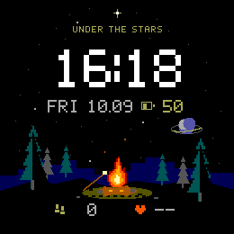

# OuterWilds

受《Outer Wilds》氛围启发的 **Garmin fēnix 7 Pro 像素篝火表盘**。

星空、松林、远方带环星球与一簇篝火。抬腕时火焰和火星缓慢变化，休眠时保留静态营地。画面为原创 Monkey C 绘图，不含游戏素材，与游戏开发商无关联。



[动态预览](preview-animated.gif) · [休眠预览](preview-sleep.png) · [完整中文说明](README-中文.md)

## 功能

- 大号像素时间，遵循手表 12/24 小时设置。
- 星期、日期、电量、当天步数和心率。
- 六帧火焰、缓慢飘动的火星、低功耗静态显示。
- 面向 47 mm fēnix 7 Pro：260 × 260、64 色 MIP。

已通过 Garmin 模拟器验证；实机色彩、抬腕表现和续航尚待确认。其他型号尚未适配。

## 安装

下载 [`CampfireUnderStars-fenix7pro.prg`](dist/CampfireUnderStars-fenix7pro.prg)，通过 USB 复制到手表的 `GARMIN/APPS` 目录。安全弹出后，在手表「表盘」中选择 **Campfire Under Stars** 并应用。

## 本地开发

安装 Garmin Connect IQ SDK、fēnix 7 Pro 设备资料和 VS Code 的 Monkey C 扩展，并配置自己的开发者密钥。

在项目目录运行：

```powershell
powershell -NoProfile -ExecutionPolicy Bypass -File .\tools\build.ps1
```

调试编译使用 `-DebugBuild`。SDK 与密钥可通过 `-SdkPath` 和 `-DeveloperKey` 指定，详细操作见[中文说明](README-中文.md)。

## 版本管理

`main` 保存开发中的版本，`v0.1.0` 是当前已确认的像素营地版本。`archive/v1/` 保留重做前的原型。

每次改动验证后，在项目目录执行：

```powershell
git status
git add source resources manifest.xml monkey.jungle tools README.md README-中文.md
git commit -m "Describe the watch face change"
git push
```

若更新了预览或安装包，一并添加对应文件。需要保存一个可随时回看的版本时，创建新的标签：

```powershell
git tag -a v0.1.1 -m "Describe this version"
git push origin v0.1.1
```

`bin/`、编译中间文件、调试信息和开发者密钥已由 `.gitignore` 排除；正式 `.prg` 安装包保存在 `dist/`。
